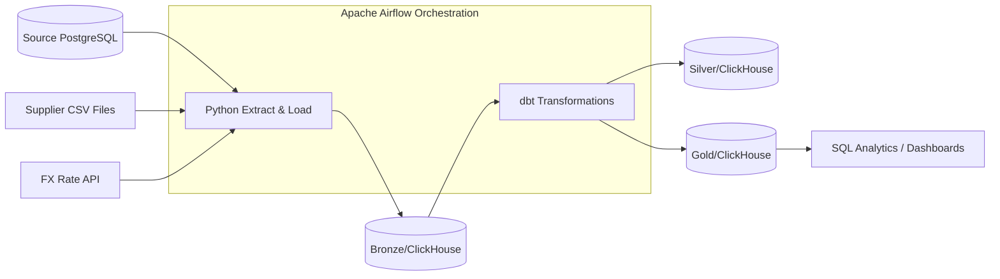

# FreshCart Data Platform Documentation

## Table of Contents
1. [Project Title and Overview](#1-project-title-and-overview)
2. [Key Features](#2-key-features)
3. [Tech Stack](#3-tech-stack)
4. [Architecture](#4-architecture)
5. [Project Structure](#5-project-structure)
6. [Getting Started](#6-getting-started)
7. [Usage](#7-usage)
8. [Database & Data Ingestion](#8-database--data-ingestion)
9. [Apache Airflow Orchestration](#9-apache-airflow-orchestration)
10. [dbt Transformations](#10-dbt-transformations)
11. [Docker & Docker Compose Setup](#11-docker--docker-compose-setup)
12. [Testing & Quality Assurance](#12-testing--quality-assurance)
13. [Deployment & Configuration](#13-deployment--configuration)
14. [Security & Best Practices](#14-security--best-practices)
15. [Knowledge Graph Insights](#15-knowledge-graph-insights)
16. [Troubleshooting / FAQ](#16-troubleshooting--faq)
17. [License and Contact](#17-license-and-contact)

---

## 1. Project Title and Overview
**FreshCart Data Platform** is an enterprise-grade data engineering capstone project designed for FreshCart, a real-time grocery delivery company.

**The Problem:** Management previously lacked reliable numbers, and Finance ran slow reports directly on the production database. 
**The Solution:** This project builds an automated, scalable data warehouse platform that ingests live transaction data, supplier CSV files, and exchange rates, processes them through tiered transformations (Bronze, Silver, Gold), and orchestrates nightly pipelines using Apache Airflow.

---

## 2. Key Features
*   **Incremental & Idempotent Ingestion**: Handles data loading daily with protection against duplicates.
*   **Star Schema Modeling**: Gold layer structured for high-performance business analytics (Revenue, Stockouts, Order Tracking).
*   **Automated Backfilling**: Native Airflow support to re-process historical data (`catchup=True`).
*   **Failure Resilience**: Automatic retries, Gmail/SMTP failure alerts, and custom sensors for supplier file availability.
*   **Quality Assurance**: Automated dbt testing and data reconciliation pipelines.

---

## 3. Tech Stack
| Layer / Tool | Technology | Purpose |
| :--- | :--- | :--- |
| **Language** | Python 3.x | Custom extraction, loaders, and Airflow task definitions. |
| **Warehouse** | ClickHouse | High-performance analytical data storage (Silver/Gold). |
| **Metadata DB** | PostgreSQL | Airflow state management and metadata. |
| **Transformation** | dbt (data build tool) | Modular data transformations, testing, and documentation. |
| **Orchestration** | Apache Airflow | Pipeline scheduling, dependency mapping, and sensor management. |
| **Infrastructure** | Docker & Docker Compose | Containerized execution environment. |

---

## 4. Architecture


---

## 5. Project Structure
```text
freshcart_data_source/
├── dags/                  # Airflow workflow definitions (Ingestion & dbt DAGs)
├── freshcart_pipline/     # dbt project directory (models, seeds, snapshots, tests)
├── ingestion/             # Python modules for DB, API, and supplier CSV extraction
├── simulator/             # Dockerized real-time company operations simulator
├── sql_tuning/            # SQL query optimization challenges and solutions
├── docs/                  # Architecture notes, project brief, and incident postmortems
└── graphify-out/          # Knowledge graph output and Obsidian vault for codebase navigation
```

---

## 6. Getting Started

### Prerequisites
- Docker & Docker Compose installed on your host machine (with at least 8GB memory and 20GB disk).

### Installation Steps
1. Clone the repository.
2. Initialize and start all services via Docker Compose:
   ```bash
   docker compose up -d --build
   ```
   *Note: Initial start-up takes approximately 25 minutes as historical data is generated and seeded.*

---

## 7. Usage
- **Check Simulator Status**:
  ```bash
  docker compose exec simulator python -m simulator status
  ```
- **Access FX API Documentation**: 
  Open `http://localhost:8000/docs` in your browser. Use the API key: `freshcart-fx-key`.
- **View Airflow UI**:
  Navigate to `http://localhost:8080` (Username: `airflow`, Password: `airflow`) to monitor DAG runs and task logs.

---

## 8. Database & Data Ingestion

The ingestion framework extracts data from the three primary sources and loads them into the ClickHouse data warehouse under the **Bronze layer**:

### A. Database Ingestion (`ingestion/database/Ingest_app.py`)
- **Purpose**: Extracts operational data (orders, customers, products) from the PostgreSQL production database (`source-db:5432`) into ClickHouse.
- **Key Functions**:
  - `extract(t, start, end)`: Queries source tables incrementally or in full loads using SQLAlchemy.
  - `write(t, rows)`: Batch loads records into ClickHouse (`freshcart_dwh`).
  - `run_database_ingestion()`: Coordinates historical and incremental synchronization with Cairo timezone awareness (`cairo_midnight_utc`).

### B. Supplier File Ingestion (`ingestion/suppliers/`)
- **Purpose**: Ingests incoming supplier CSV files (`source_files/suppliers/fresh/` and `general/`).
- **Modules**:
  - `DDL/DDL_fresh_suppliers.py` & `DDL_general_suppliers.py`: Dynamically inspects CSV headers, hashes schemas, ensures idempotent ClickHouse table creation (`bronze_suppliers`), and maintains an `ingested_files` deduplication ledger.
  - `Load/Load_fresh_suppliers.py` & `Load_general_suppliers.py`: Parses incoming CSVs, computes file digests (`sha256`), checks the ledger, and loads new rows with full metadata (`batch_id`, `source_file`, `source_row_number`, `ingested_at`).

### C. Exchange Rate API Ingestion (`ingestion/fx_api/`)
- **Purpose**: Collects current and historical currency exchange rates from the `fx-api` service (`http://fx-api:8000`).
- **Modules**:
  - `DDL/`: Defines raw Bronze tables (`rates`, `history`, `currencies`, `health_check`) in `bronze_fx_api`.
  - `Load/history.py`: Fetches 30-day historical windows using robust retry adapters (`urllib3` / `requests`) and idempotent payload insertion.
  - `connection_clickhouse.py`: Shared database connector wrapper (`CHClient`) providing `clickhouse-connect` integration with standard `.execute()` syntax.

---

## 9. Apache Airflow Orchestration

Airflow orchestrates the entire data pipeline (`dags/Ingedtion_dag.py`):
- **Executors & Backend**: Configured with **CeleryExecutor**, backed by **PostgreSQL** (`postgres`) and message brokered by **Redis**.
- **DAG Workflow**:
  1. **Supplier Files Sensor / Trigger (`supplier_files_ready`)**: Detects new supplier CSV arrivals and triggers ingestion tasks.
  2. **Database Ingestion Task**: Runs scheduled incremental extracts from PostgreSQL to ClickHouse.
  3. **FX API Ingestion Task**: Pulls currency rates daily.
  4. **dbt Transformation Tasks**: Triggered downstream via Cosmos/Airflow operators to build Silver and Gold data models.
- **Alerting**: Integrated Gmail SMTP alerts (`task_failure_alert`) for task failures.

---

## 10. dbt Transformations (`freshcart_pipline`)

Transformed models reside inside ClickHouse and are managed via dbt:
- **Sources (`models/source.yaml`)**: Points to Bronze tables (`bronze_app`, `bronze_suppliers`, `bronze_fx_api`).
- **Silver Layer (`models/silver/`)**: Cleaned, typed, and deduplicated staging models (e.g., `silver_history.sql`, `silver_orders`).
- **Gold Layer (`models/gold/`)**: Dimensional models and analytics-ready business views (e.g., SCD Type 2 product price history `dim_product_price_history.sql`).

---

## 11. Docker & Docker Compose Setup (`docker-compose.yml`)

The platform runs entirely containerized:
- **The Company Stack**:
  - `source-db` (Postgres 16 on port `5433` / `5432`)
  - `simulator` (Generates orders & supplier files)
  - `fx-api` (FastAPI exchange rate provider on port `8000`)
- **Your Data Platform Stack**:
  - `clickhouse` (ClickHouse server on HTTP port `8123` & Native port `9000`)
  - `postgres` & `redis` (Airflow infrastructure)
  - `airflow-apiserver`, `airflow-scheduler`, `airflow-worker`, `airflow-dag-processor`, `airflow-init` (Apache Airflow 3.2.1 ecosystem on port `8080`)
  - `flower` (Celery monitoring on port `5555`)

---

## 12. Testing & Quality Assurance
- **dbt Testing**: Executed automatically post-model build via Astronomer Cosmos (`test_behavior=TestBehavior.AFTER_EACH`). Includes primary key uniqueness, relationship constraints, and custom reconciliation tests.

---

## 13. Deployment & Configuration

### Environment Variables (.env)
Key configurations are managed via the `.env` file:
| Variable Name | Description | Required | Example Value |
| :--- | :--- | :--- | :--- |
| `SOURCE_DB_PASSWORD` | Production DB password | Yes | `freshcart` |
| `CLICKHOUSE_PASSWORD`| ClickHouse Warehouse password | Yes | `freshcart_ch_pass` |
| `FX_API_KEY` | Exchange-rate provider token | Yes | `freshcart-fx-key` |
| `ALERT_EMAIL_USER` | Gmail account for failure notifications | Yes | `user@gmail.com` |

---

## 14. Security & Best Practices
- **Read-Only Access**: Analytics and ingestion pipelines utilize read-only database accounts to protect production data.
- **Secrets Management**: Sensitive credentials are stored in environment variables (`.env`) and injected securely into containers.

---

## 15. Knowledge Graph Insights (Graphify Analysis)
Based on structural and semantic graph analysis of this repository (`533 nodes`, `1036 edges` across `40 communities`):
- **Top God Nodes**: `environment` (Docker configuration & environment variables) and `connection_clickhouse()` (Central database connectivity backbone).
- **Surprising Connections**: Conceptual bridges between the **Project Brief** and historical **Postmortems** (e.g., duplicate payments, FX outages, and supplier file layout changes).

---

## 16. Troubleshooting / FAQ
- **Missing Data**: Run `docker compose exec simulator python -m simulator status` to verify the simulator is producing daily orders.
- **Vertical Scrolling Issues**: Use Windows Terminal instead of the legacy console to correctly handle ANSI escape sequences.

---

## 17. License and Contact
- **License**: *TODO: Add a formal LICENSE file.*
- **Contact**: Data Engineering Team - Ahmed Nabil & Mohamed Mosaad.
