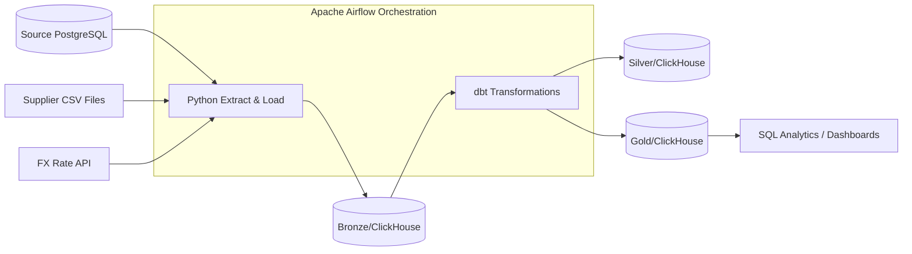

# FreshCart Data Platform Documentation

## Table of Contents
1. [Project Title and Overview](#1-project-title-and-overview)
2. [Key Features](#2-key-features)
3. [Tech Stack](#3-tech-stack)
4. [Architecture](#4-architecture)
5. [Project Structure](#5-project-structure)
6. [Getting Started](#6-getting-started)
7. [Usage](#7-usage)
8. [Database](#8-database)
9. [Testing](#9-testing)
10. [Deployment & CI/CD](#10-deployment--cicd)
11. [Configuration & Environment Variables](#11-configuration--environment-variables)
12. [Security and Best Practices](#12-security-and-best-practices)
13. [Troubleshooting / FAQ](#13-troubleshooting--faq)
14. [License and Contact](#14-license-and-contact)

---

## 1. Project Title and Overview
**FreshCart Data Platform** is an enterprise-grade data engineering capstone project designed for FreshCart, a real-time grocery delivery company.

**The Problem:** Management previously lacked reliable numbers, and Finance ran slow reports directly on the production database. 
**The Solution:** This project builds an automated, scalable data warehouse platform that ingests live transaction data, supplier CSV files, and exchange rates, processes them through tiered transformations (Bronze, Silver, Gold), and orchestrates nightly pipelines using Apache Airflow.

---

## 2. Key Features
*   **Incremental & Idempotent Ingestion**: Handles data loading daily with protection against duplicates.
*   **Star Schema Modeling**: Gold layer structured for high-performance business analytics (Revenue, Stockouts, Order Tracking).
*   **Automated Backfilling**: Native Airflow support to re-process historical data (`catchup=True`).
*   **Failure Resilience**: Automatic retries, Gmail/SMTP failure alerts, and custom sensors for supplier file availability.
*   **Quality Assurance**: Automated dbt testing and data reconciliation pipelines.

---

## 3. Tech Stack
| Layer / Tool | Technology | Purpose |
| :--- | :--- | :--- |
| **Language** | Python 3.x | Custom extraction, loaders, and Airflow task definitions. |
| **Warehouse** | ClickHouse | High-performance analytical data storage (Silver/Gold). |
| **Metadata DB** | PostgreSQL | Airflow state management and metadata. |
| **Transformation** | dbt (data build tool) | Modular data transformations, testing, and documentation. |
| **Orchestration** | Apache Airflow | Pipeline scheduling, dependency mapping, and sensor management. |
| **Infrastructure** | Docker & Docker Compose | Containerized execution environment. |

---

## 4. Architecture


---

## 5. Project Structure
```text
freshcart_data_source/
├── dags/                  # Airflow workflow definitions (Ingestion & dbt DAGs)
├── freshcart_pipline/     # dbt project directory (models, seeds, snapshots, tests)
├── ingestion/             # Python modules for DB, API, and supplier CSV extraction
├── simulator/             # Dockerized real-time company operations simulator
├── sql_tuning/            # SQL query optimization challenges and solutions
├── docs/                  # Architecture notes, project brief, and incident postmortems
└── graphify-out/          # Knowledge graph output and Obsidian vault for codebase navigation
```

---

## 6. Getting Started

### Prerequisites
- Docker & Docker Compose installed on your host machine.

### Installation Steps
1. Clone the repository.
2. Initialize and start all services via Docker Compose:
   ```bash
   docker-compose up -d --build
   ```
   *Note: Initial start-up takes approximately 25 minutes as historical data is generated and seeded.*

---

## 7. Usage
- **Check Simulator Status**:
  ```bash
  docker-compose exec simulator python -m simulator status
  ```
- **Access FX API Documentation**: 
  Open `http://localhost:8000/docs` in your browser. Use the API key: `freshcart-fx-key`.
- **View Airflow UI**:
  Navigate to `http://localhost:8080` (or configured port) to monitor DAG runs and task logs.

---

## 8. Database
- **ClickHouse Warehouse**: The primary analytical engine for the platform.
- **Silver Schema**: Cleaned, deduplicated tables with standardized schemas and anomaly flags.
- **Gold Schema**: Star schema dimensions and fact tables optimized for business intelligence queries.

---

## 9. Testing
- **dbt Testing**: Executed automatically post-model build via Astronomer Cosmos (`test_behavior=TestBehavior.AFTER_EACH`). Includes primary key uniqueness, relationship constraints, and custom reconciliation tests.

---

## 10. Deployment & CI/CD
- **Deployment**: Fully containerized using Docker Compose for local simulation and deployment readiness.
- **CI/CD Pipeline**: *TODO: Automated remote CI/CD pipelines (GitHub Actions/GitLab CI) are not yet configured.*

---

## 11. Configuration & Environment Variables
Key configurations are managed via the `.env` file:
| Variable Name | Description | Required | Example Value |
| :--- | :--- | :--- | :--- |
| `SOURCE_DB_PASSWORD` | Production DB password | Yes | `freshcart` |
| `CLICKHOUSE_PASSWORD`| ClickHouse Warehouse password | Yes | `freshcart_ch_pass` |
| `FX_API_KEY` | Exchange-rate provider token | Yes | `freshcart-fx-key` |
| `ALERT_EMAIL_USER` | Gmail account for failure notifications | Yes | `user@gmail.com` |

---

## 12. Security and Best Practices
- **Read-Only Access**: Analytics and ingestion pipelines utilize read-only database accounts to protect production data.
- **Secrets Management**: Sensitive credentials are stored in environment variables (`.env`) and injected securely into containers.

---

## 13. Troubleshooting / FAQ
- **Missing Data**: Run `docker-compose exec simulator python -m simulator status` to verify the simulator is producing daily orders.
- **Vertical Scrolling Issues**: Use Windows Terminal instead of the legacy console to correctly handle ANSI escape sequences.

---

## 14. License and Contact
- **License**: *TODO: Add a formal LICENSE file.*
- **Contact**: Data Engineering Team - Ahmed Nabil & Mohamed Mosaad.
